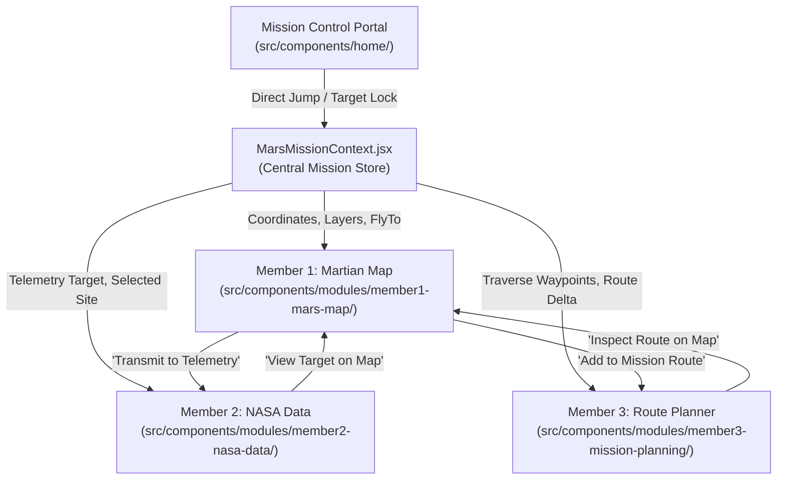

# Interplanetary Survival Guide: Martian Map 🚀🔴

> Collaborative Multi-Member Planetary Science & Survival Project for Mars Exploration.
> Developed for the NASA Space Apps Challenge by a three-member team using React, JavaScript, HTML5 Canvas, Three.js WebGL, CSS Modules, and Vite.

---

## 👨‍🚀 Team Architecture & Module Division

This project integrates three specialized engineering subsystems under a unified, modular repository structure where each team member owns a dedicated module directory under `src/components/modules/`:

| Member | Module Directory | Assigned Responsibility | Integration Status |
| :--- | :--- | :--- | :--- |
| **Mission Control** | `src/components/home/` | **Central Project Portal & Telemetry Hub** | **✅ Fully Functional & Complete** |
| **Member 1** | `src/components/modules/member1-mars-map/` | **Interactive Mars Map & Areocentric Cartography** | **✅ Fully Functional & Complete** |
| **Member 2** | `src/components/modules/member2-nasa-data/` | **NASA Scientific Telemetry, PDS Weather & Rover API** | **✅ Fully Functional & Complete** |
| **Member 3** | `src/components/modules/member3-mission-planning/` | **Terrain Analysis, Hazard Avoidance & Route Logistics** | **✅ Fully Functional & Complete** |

---

## 🛰️ 1. Mission Control Portal (Homepage)

- **Central Aerospace Command Dashboard**: Real-time Earth-Mars light-speed communication latency clock (14m 18s at 248.2M km), Martian Epoch (MY 37, $L_s$ 145.8°), active surface fleet tracking (Perseverance, Curiosity, Zhurong).
- **Subsystem Showcase Cards**: Interactive launch cards with direct deep links into Member 1, Member 2, and Member 3 modules.
- **Interplanetary Survival Directives**: Quick reference matrix for atmospheric management (95.3% CO2, MOXIE O2 extraction), 7.2 hPa surface pressure, diurnal thermal swings (-18°C to -95°C), and toxic regolith perchlorate ($ClO_4^-$) decontamination.
- **Quick Target Lock**: Instant fly-to selection for Jezero Crater, Olympus Mons, Valles Marineris, Arcadia Planitia, Hellas Basin, and Gale Crater.
- **Team Roster**: Direct attribution and architecture overview honoring each member's contributions.

---

## 🗺️ 2. Member 1: Interactive Mars Map & Cartography

1. **Dual-Engine Interactive Mapping**:
   - **2D Surface Map Canvas**: Smooth panning, mouse-wheel/pinch zooming (1x to 8x), and equirectangular coordinate projection.
   - **3D Orbital Globe (Three.js WebGL)**: Photorealistic rotating Martian sphere, custom atmospheric glow shader, procedural starfield, and 3D spherical coordinate raycast pin projections.

2. **Multi-Spectral Optical Layers**:
   - **NASA Viking Optical Mosaic**: True-color iron oxide albedo and basalt plains.
   - **MOLA Topographic Elevation**: Color-coded laser altimetry (-8 km blue to +22 km white).
   - **THEMIS Daytime Thermal Infrared**: Thermal inertia and bedrock emissivity gradients.
   - **Tactical Shaded Relief**: High-contrast hillshade highlighting crater rims and canyon escarpments.
   - **Subsurface Water Ice Overlay**: Radar-derived glacier deposits across Utopia & Arcadia Planitia.

3. **Rich Martian Landmark Database (25+ Authentic Sites)**:
   - **Active Rovers**: Perseverance & Ingenuity (Jezero Crater Delta), Curiosity (Gale Crater / Mount Sharp), Zhurong.
   - **Historic Landers**: InSight (Elysium Planitia), Viking 1 & 2, Opportunity (Meridiani Planum), Spirit (Gusev Crater).
   - **Extreme Volcanic Peaks**: Olympus Mons (21.9 km peak), Tharsis Montes (Ascraeus, Pavonis, Arsia Mons).
   - **Tectonic Chasmata**: Valles Marineris (4,000 km grand canyon rift), Noctis Labyrinthus, Candor Chasma.
   - **Impact Basins**: Hellas Planitia (deepest basin, 12.4 mbar), Argyre Planitia.
   - **Glacial Reserves & Colonies**: Arcadia Planitia (Starship colony zone), Utopia Planitia, Korolev Crater ice dome.

4. **Real-Time Geodesy & Coordinate HUD**:
   - Real-time cursor coordinates in Areocentric Latitude & Longitude (Decimal and DMS notation).
   - Continuous MOLA elevation datum estimation.
   - Coordinated Mars Time (MTC) and Solar Longitude ($L_s$) seasonal tracking.

5. **Location Dossier & Survival Viability Rating**:
   - Scientific background, viability rating (1-100), and water-ice/atmospheric constraints.
   - Actions: *Fly to Target*, *Copy Coordinates*, *Transmit to Telemetry* (connects to Member 2), and *Add to Mission Route* (connects to Member 3).

6. **Custom Survival Beacons**:
   - Interactive modal allowing colonists to drop custom GPS beacons with life-support supply notes.

---

## 📡 3. Member 2: NASA Scientific Data Integration

1. **Authentic NASA Science Telemetry**:
   - Live NASA Planetary Data System (PDS) archives, GSFC planetary constants, and active fleet statuses (Perseverance, Curiosity, MRO, Odyssey, InSight).
2. **MEDA Weather Observations**:
   - Mars 2020 Perseverance MEDA 7-Sol calibrated atmospheric weather records (Sol 915-921) at Jezero Crater: diurnal pressure cycles, ambient temperatures, and dust optical depth ($\tau = 0.37$).
3. **Thermal Regimes (Odyssey THEMIS)**:
   - Global thermal inertia benchmarks and diurnal surface vs subsurface (-10cm) temperature damping curves.
4. **Geological & Mineral Regimes**:
   - Regolith oxide abundance assays ($SiO_2$, $FeO$, $MgO$, $Al_2O_3$, $SO_3$) with active medical warnings for toxic **Perchlorates ($ClO_4^-$)**.
   - CRISM hyperspectral hydrated mineral identification (clays, sulfates, olivine, carbonates).
5. **Topography & Elevation Profiles**:
   - MGS MOLA 0m datum (610.5 Pa water triple point reference) with a 250 km cross-sectional elevation transect of Valles Marineris.
6. **Mars Rover Imagery & NASA Open API**:
   - Live query engine connecting to NASA Mars Rover Photos API + curated high-resolution JPL gallery with instrument filter and metadata modal.
7. **Cross-Module Telemetry Lock**:
   - Automatically detects targets transmitted from Member 1's map, locking onto the coordinates and displaying localized scientific data.

---

## 🚀 4. Member 3: Terrain Analysis, Hazards & Route Logistics

1. **Interactive Terrain Altimetry & Slope Analysis**:
   - Laser altimetry cross-section charts, real-time slope gauges, and surface roughness indicators.
2. **Hazard Identification & Avoidance**:
   - Active hazard warning system classifying steep scarps (>25°), sand ripple slippage risks, and boulder fields with risk severity filtering.
3. **Verified Scientific Points of Interest (POIs)**:
   - Detailed geological POI cards (Olympus Mons, Valles Marineris, Jezero, Gale, Hellas) with 1-click "Set as Mission Destination" routing.
4. **Automated Traverse Route Planner**:
   - Real-time route generation calculating cumulative distance (km), elevation delta, and traverse safety factor between Martian coordinates.
5. **Mission Planning Dashboard**:
   - Mission operational status, interactive objective checklist tracker, selected location management, and executive briefing summary modal.
6. **Cross-Module Route Sync**:
   - Detects waypoints added from Member 1's map, automatically computing traverse distances and enabling seamless round-trip navigation.

---

## 🔌 Cross-Module Integration Architecture

All three modules communicate seamlessly through the central mission context (`src/context/MarsMissionContext.jsx`):



---

## 💻 Running the Integrated Application

### 1. Install Dependencies
```bash
npm install
```

### 2. Start Vite Development Server
```bash
npm run dev
```
Open your browser at `http://localhost:3000/`.

### 3. Production Build
```bash
npm run build
npm run preview
```

The optimized production bundle is generated inside `dist/` with automated code-splitting for Three.js WebGL and core vendor dependencies.
